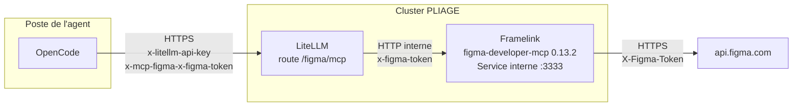
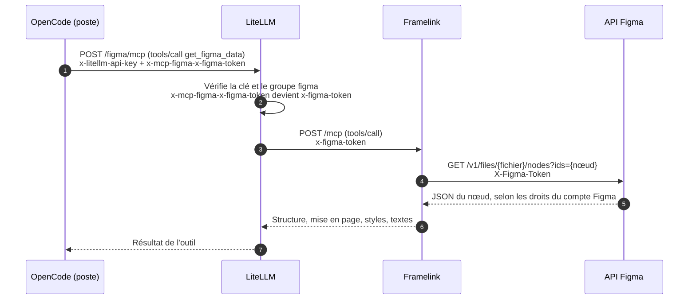

# MCP Figma derrière LiteLLM PLIAGE, avec le jeton Figma de chaque utilisateur

Proposition d'architecture du 30/10/2026, à destination de l'équipe infra. **Statut : non testée de bout en bout.** Les comportements de LiteLLM et de Framelink décrits ici ont été vérifiés dans leur code source (versions indiquées), pas sur un déploiement.

## En bref (version sans schéma)

- **Objectif.** Donner aux agents l'accès à leurs maquettes Figma depuis leur assistant de code (OpenCode), en ne passant que par LiteLLM, comme pour les autres MCP. Chacun doit garder ses propres droits Figma : on ne voit que les fichiers auxquels son compte Figma a accès.
- **Pourquoi pas le MCP officiel de Figma.** Il exige l'OAuth et n'accepte que les clients d'une liste fermée (VS Code, Cursor, Claude Code…). LiteLLM n'y figure pas, et les jetons personnels y sont refusés.
- **La solution.** Déployer sur le cluster **Framelink** (`figma-developer-mcp`, projet open source sous licence MIT), un serveur MCP qui appelle l'API REST de Figma. Il accepte un jeton Figma différent à chaque requête, dans l'en-tête `X-Figma-Token`. LiteLLM relaie ce jeton depuis le poste de l'utilisateur.
- **Ce qu'on demande à l'infra.** Un conteneur Node sans état, un Service interne (pas d'Ingress), une sortie HTTPS vers `api.figma.com`. Aucun secret à stocker côté serveur.
- **Ce qui ne change pas.** Le poste n'appelle que LiteLLM. Les droits d'accès au MCP restent gérés dans LiteLLM (groupe d'accès `figma`).
- **Ce que voit passer le jeton Figma.** Le poste, LiteLLM et Framelink, en mémoire, le temps de la requête. Rien n'est stocké côté serveur.

## Pourquoi pas le MCP officiel de Figma

| Option | Verdict | Raison |
|---|---|---|
| MCP distant officiel `https://mcp.figma.com/mcp` | Exclu | OAuth seulement, et « Only clients listed in the Figma MCP catalog […] can connect » ([doc Figma](https://developers.figma.com/docs/figma-mcp-server/remote-server-installation/)). Les jetons personnels sont refusés ([réponse Figma sur le forum](https://forum.figma.com/suggest-a-feature-11/support-for-pat-personal-access-token-based-auth-in-figma-remote-mcp-47465)). |
| MCP local de Figma Desktop (`127.0.0.1:3845`) | Exclu | Tourne sur le poste et nécessite l'application Figma Desktop : contraire à la règle « le poste n'appelle que LiteLLM ». |
| Framelink en `stdio` lancé par LiteLLM | Exclu | Le jeton serait fixé au lancement, donc commun à tous. Ce mode nécessite aussi Node dans l'image LiteLLM et l'activation du stdio. |
| **Framelink en HTTP sur le cluster** | **Retenu** | Jeton par requête (`X-Figma-Token`), sans état, aucun secret côté serveur. |

## Architecture

### Vue d'ensemble



En texte : OpenCode envoie la requête MCP à LiteLLM en HTTPS avec deux en-têtes, la clé LiteLLM de l'utilisateur et son jeton Figma préfixé par `x-mcp-figma-`. LiteLLM vérifie la clé et le droit au serveur `figma`, retire le préfixe et transmet `x-figma-token` à Framelink sur le réseau interne du cluster. Framelink appelle l'API Figma avec ce jeton et renvoie une version simplifiée de la maquette.

### Déroulé d'un appel



En texte, étape par étape :

1. OpenCode appelle l'outil `get_figma_data` via `POST /figma/mcp` sur LiteLLM, avec la clé LiteLLM et l'en-tête `x-mcp-figma-x-figma-token`.
2. LiteLLM authentifie la clé et vérifie qu'elle a accès au groupe `figma`. Il découpe l'en-tête : serveur `figma`, en-tête `x-figma-token`.
3. LiteLLM appelle Framelink en ajoutant `x-figma-token`.
4. Framelink appelle `GET https://api.figma.com/v1/files/{fichier}/nodes?ids={nœud}` avec `X-Figma-Token`.
5. Figma répond selon les droits du compte qui a créé le jeton.
6. et 7. Framelink simplifie la réponse (structure, mise en page, styles, textes), qui remonte jusqu'à OpenCode.

### Ce qui a été vérifié dans le code

- **LiteLLM v1.85.7** ([`user_api_key_auth_mcp.py`](https://github.com/BerriAI/litellm/blob/v1.85.7/litellm/proxy/_experimental/mcp_server/auth/user_api_key_auth_mcp.py), [`oauth2_token_cache.py`](https://github.com/BerriAI/litellm/blob/v1.85.7/litellm/proxy/_experimental/mcp_server/oauth2_token_cache.py), [`client.py`](https://github.com/BerriAI/litellm/blob/v1.85.7/litellm/experimental_mcp_client/client.py)) :
  - les en-têtes `x-mcp-{serveur}-{en-tête}` sont découpés au premier tiret, en minuscules ;
  - l'en-tête fourni par l'utilisateur passe avant toute auth configurée sur le serveur ;
  - il est ajouté tel quel à l'appel, même si le serveur est déclaré sans auth (`none`).
- **Framelink 0.13.2** ([`server.ts`](https://github.com/GLips/Figma-Context-MCP/blob/main/src/server.ts)) :
  - en HTTP, lit `X-Figma-Token` (jeton personnel) ou `Authorization: Bearer` (jeton OAuth) à chaque requête ;
  - n'exige aucun jeton au démarrage hors mode `stdio` ;
  - sans état (une instance MCP par requête), donc plusieurs réplicas sont possibles sans affinité de session.

## Ce qu'on demande à l'infra

### 1. Image

Version épinglée, installée au build (pas de `npx` au démarrage, donc pas d'accès au registre npm en production).

```dockerfile
FROM node:24-alpine
RUN npm install -g figma-developer-mcp@0.13.2 && npm cache clean --force
ENV FRAMELINK_HOST=0.0.0.0 \
    FRAMELINK_PORT=3333 \
    FRAMELINK_TELEMETRY=off \
    DO_NOT_TRACK=1 \
    SKIP_IMAGE_DOWNLOADS=true
USER node
EXPOSE 3333
CMD ["figma-developer-mcp"]
```

| Variable | Valeur | Pourquoi |
|---|---|---|
| `FRAMELINK_HOST` | `0.0.0.0` | Par défaut, Framelink n'écoute que sur `127.0.0.1`, injoignable depuis un autre pod. |
| `FRAMELINK_PORT` | `3333` | Port par défaut, rendu explicite. |
| `FRAMELINK_TELEMETRY` et `DO_NOT_TRACK` | `off` et `1` | La télémétrie est **activée par défaut** et part vers PostHog (`us.i.posthog.com`). Une seule des deux suffit ; les deux par sécurité. |
| `SKIP_IMAGE_DOWNLOADS` | `true` | Retire l'outil `download_figma_images`, qui écrit des fichiers sur le disque **du serveur** : inutile et indésirable sur une instance partagée. Seul `get_figma_data` reste exposé. |

Aucune variable `FIGMA_API_KEY` ni `FIGMA_OAUTH_TOKEN` : sans jeton commun, une requête sans jeton utilisateur échoue au lieu d'utiliser le compte de quelqu'un d'autre.

Node : le paquet demande Node ≥ 20.20 ; le dépôt utilise Node 24.

### 2. Déploiement Kubernetes (exemple à adapter à vos charts)

```yaml
apiVersion: apps/v1
kind: Deployment
metadata:
  name: figma-mcp
spec:
  replicas: 1
  selector:
    matchLabels: { app: figma-mcp }
  template:
    metadata:
      labels: { app: figma-mcp }
    spec:
      securityContext:
        runAsNonRoot: true
      containers:
        - name: figma-mcp
          image: <registre>/figma-mcp:0.13.2
          ports:
            - containerPort: 3333
          readinessProbe:
            tcpSocket: { port: 3333 }
          livenessProbe:
            tcpSocket: { port: 3333 }
          resources:
            requests: { cpu: 50m, memory: 128Mi }
            limits: { memory: 512Mi }
          securityContext:
            allowPrivilegeEscalation: false
            readOnlyRootFilesystem: true
            capabilities: { drop: ["ALL"] }
---
apiVersion: v1
kind: Service
metadata:
  name: figma-mcp
spec:
  selector: { app: figma-mcp }
  ports:
    - port: 3333
      targetPort: 3333
---
apiVersion: networking.k8s.io/v1
kind: NetworkPolicy
metadata:
  name: figma-mcp
spec:
  podSelector:
    matchLabels: { app: figma-mcp }
  policyTypes: [Ingress]
  ingress:
    - from:
        - podSelector:
            matchLabels: { app: litellm }   # à adapter aux labels des pods LiteLLM (et namespaceSelector si autre namespace)
      ports:
        - port: 3333
```

Points d'attention :

- **Pas d'Ingress.** Framelink n'a pas d'authentification propre. Exposé publiquement, il servirait de relais ouvert vers l'API Figma. Seul LiteLLM doit pouvoir l'appeler.
- **Sondes.** Il n'y a pas de route de santé : `GET /mcp` répond 405 (seul `POST` est accepté). D'où les sondes TCP.
- **Ressources.** Valeurs indicatives, non mesurées. La mémoire dépend de la taille des fichiers Figma lus.
- **`readOnlyRootFilesystem`.** Avec `SKIP_IMAGE_DOWNLOADS=true`, Framelink n'écrit rien sur disque d'après le code. À confirmer au premier démarrage.

### 3. Sortie réseau

- Sortie HTTPS vers `api.figma.com:443` uniquement (plus le DNS).
- Si la sortie passe par un proxy : Framelink prend en compte `HTTPS_PROXY` et `NO_PROXY` (code de `server.ts`).

## Déclaration dans LiteLLM (admin LiteLLM)

Page **MCP Servers** > **Add New MCP Server** > **Custom Server** :

| Champ | Valeur |
|---|---|
| MCP Server Name et Alias | `figma`, en minuscules, sans tiret ni tiret bas (voir plus bas) |
| Transport | Streamable HTTP |
| MCP Server URL | `http://figma-mcp.<namespace>.svc.cluster.local:3333/mcp` |
| Authentication | None (le jeton vient de l'utilisateur) |
| MCP Access Groups | `figma` |
| Allow All LiteLLM Keys | Désactivé |

Pourquoi ce nom : LiteLLM met en minuscules et découpe au premier tiret l'en-tête `x-mcp-{serveur}-{en-tête}`. Un nom avec majuscule ou tiret ne serait jamais reconnu. Les tirets bas sont souvent supprimés des noms d'en-têtes par les reverse proxies (nginx par défaut).

Le test de connexion de l'interface échouera sans doute à la création, faute de jeton. Ce n'est pas bloquant : la liste des outils se charge à la première requête d'un utilisateur.

Les droits se donnent ensuite par clé ou par équipe : voir [tuto_mcp_gestion-des-droits.md](tuto_mcp_gestion-des-droits.md).

## Côté utilisateur

1. **Siège Figma.** Il faut un siège **Dev** ou **Full** dans l'abonnement Figma qui possède les fichiers. Depuis le 17/11/2025, les sièges View et Collab sont limités à environ 6 appels **par mois** sur les points d'accès de lecture de fichier ([limites de l'API REST](https://developers.figma.com/docs/rest-api/rate-limits), [aide Figma](https://help.figma.com/hc/en-us/articles/34963238552855-What-if-I-m-rate-limited)) : inutilisable en pratique.
2. **Jeton personnel Figma.** Figma > Paramètres > Sécurité > Personal access tokens. Lecture seule sur le contenu des fichiers (`file_content:read` a priori suffisant, à confirmer au test), avec une date d'expiration.
3. **Variable d'environnement**, comme la clé LiteLLM : sous Windows, `setx FIGMA_TOKEN "figd_..."` puis rouvrir le terminal.
4. **Config OpenCode** (le jeton n'est jamais écrit dans le fichier) :

```json
{
  "$schema": "https://opencode.ai/config.json",
  "mcp": {
    "figma": {
      "type": "remote",
      "url": "https://litellm.pliage-prod.socle-ia.data-ia.prod.atlas.fabrique.social.gouv.fr/figma/mcp",
      "headers": {
        "x-litellm-api-key": "Bearer {env:LITELLM_API_KEY}",
        "x-mcp-figma-x-figma-token": "{env:FIGMA_TOKEN}"
      }
    }
  }
}
```

5. **Usage** : « récupère la maquette https://www.figma.com/design/<fichier>/…?node-id=4003-663 ».

Le jeton personnel doit passer dans `x-figma-token`, pas dans `authorization` : Framelink traite tout `Authorization: Bearer` comme un jeton OAuth.

## Sécurité : où passe le jeton Figma

| Étape | Voit le jeton | Stocké |
|---|---|---|
| Poste | Oui (variable d'environnement de l'utilisateur) | Oui, sur le poste |
| Ingress du cluster | En-tête HTTPS déchiffré au niveau de l'Ingress | Non, sauf journalisation des en-têtes : à vérifier |
| LiteLLM | Oui, en mémoire | Non. En niveau de log `DEBUG`, LiteLLM écrit les 10 premiers caractères de la valeur (`figd_` + 5 caractères). Garder un niveau `INFO` ou plus. |
| Framelink | Oui, en mémoire, le temps de la requête | Non. Le jeton est masqué dans ses messages d'erreur. Télémétrie coupée. |
| API Figma | Oui | Côté Figma |

Le jeton donne les droits de lecture de son propriétaire sur Figma, rien de plus. Il se révoque à tout moment depuis les paramètres Figma de l'utilisateur.

## Limites connues

- **Projet communautaire.** Framelink n'est pas édité par Figma. Version épinglée (0.13.2 du 18/06/2026) ; toute montée de version se fait par reconstruction de l'image, après lecture du changelog.
- **Contenu.** Framelink renvoie la structure, la mise en page, les styles et les textes. Il ne génère pas de code et ne connaît pas Code Connect, contrairement au MCP officiel en Dev Mode.
- **Quotas Figma** par utilisateur et par abonnement : un usage intensif peut renvoyer des erreurs 429 côté Figma.

## Recette

À dérouler dans l'ordre. Remplacer `<svc>` par l'adresse interne du Service, et lancer les étapes 1 et 2 depuis un pod du namespace de LiteLLM.

**1. Framelink répond, sans jeton.** Doit lister un seul outil, `get_figma_data` :

```bash
curl -s http://<svc>:3333/mcp \
  -H 'Content-Type: application/json' -H 'Accept: application/json, text/event-stream' \
  -d '{"jsonrpc":"2.0","id":1,"method":"tools/list"}'
```

**2. Un appel sans jeton échoue proprement.** Attendu : « Figma API authentication is required. […] send X-Figma-Token / Authorization: Bearer on the HTTP request. »

```bash
curl -s http://<svc>:3333/mcp \
  -H 'Content-Type: application/json' -H 'Accept: application/json, text/event-stream' \
  -d '{"jsonrpc":"2.0","id":2,"method":"tools/call","params":{"name":"get_figma_data","arguments":{"fileKey":"<fichier>","nodeId":"4003-663"}}}'
```

**3. Bout en bout via LiteLLM**, depuis un poste, avec une clé LiteLLM qui a le groupe `figma` et le jeton Figma d'un compte qui a accès au fichier :

```bash
curl -s https://litellm.pliage-prod.socle-ia.data-ia.prod.atlas.fabrique.social.gouv.fr/figma/mcp \
  -H 'Content-Type: application/json' -H 'Accept: application/json, text/event-stream' \
  -H "x-litellm-api-key: Bearer $LITELLM_API_KEY" \
  -H "x-mcp-figma-x-figma-token: $FIGMA_TOKEN" \
  -d '{"jsonrpc":"2.0","id":3,"method":"tools/call","params":{"name":"get_figma_data","arguments":{"fileKey":"<fichier>","nodeId":"4003-663"}}}'
```

Le nom de l'outil vu à travers LiteLLM peut être préfixé par le nom du serveur (`figma-get_figma_data`). En cas d'erreur « outil inconnu », lancer d'abord `tools/list` sur la même URL pour lire le nom exact.

**4. Cloisonnement.** Refaire l'étape 3 avec le jeton d'un compte **sans** accès au fichier : Figma doit refuser (403 ou 404).

**En cas de problème**

- `Invalid Host header` ou 403 dès l'étape 1 : le SDK MCP utilisé par Framelink peut filtrer l'en-tête `Host`. Vérifier les logs du pod et appeler le Service par son nom DNS complet.
- Étape 3 en 401 : clé LiteLLM invalide ou sans le groupe `figma`.
- Étape 3 avec l'erreur d'authentification Figma de l'étape 2 : l'en-tête `x-mcp-figma-x-figma-token` n'arrive pas. Vérifier le nom exact du serveur dans LiteLLM (`figma`, en minuscules) et que l'Ingress ne filtre pas les en-têtes.

## Références

- Framelink : [GLips/Figma-Context-MCP](https://github.com/GLips/Figma-Context-MCP), paquet npm [`figma-developer-mcp`](https://www.npmjs.com/package/figma-developer-mcp)
- LiteLLM, en-têtes par serveur MCP : [documentation MCP](https://docs.litellm.ai/docs/mcp)
- Figma : [MCP distant](https://developers.figma.com/docs/figma-mcp-server/remote-server-installation/), [limites de l'API REST](https://developers.figma.com/docs/rest-api/rate-limits)
- Même principe appliqué à Jira : serveur `jiratoken` dans LiteLLM (jeton API Atlassian par utilisateur)
